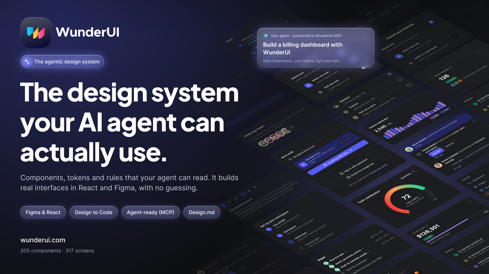

<p align="center">
  <a href="https://wunderui.com"></a>
</p>

<p align="center">
  <a href="https://wunderui.com">Website</a> ·
  <a href="https://wunderui.com/components">Components</a> ·
  <a href="https://wunderui.com/figma">Figma</a> ·
  <a href="https://wunderui.com/#pricing">Pricing</a>
</p>

<p align="center">
  
  
  
  
  
</p>

# WunderUI Free

**89 of the 194 WunderUI React components, free as source you own.** Built on Base UI and Tailwind CSS v4, styled by the same tokens as the WunderUI Figma library, light and dark, accessible (WCAG AA contrast on every token pair), and documented with live examples on [wunderui.com](https://wunderui.com).

Copy the files into your project and they are yours: no package to update, no lock-in, MIT licence.

## Quick start

Requirements: React 19.3 or newer, Tailwind CSS v4, and the `@/*` path alias pointing at your source root (the default in Next.js projects).

**The quick way:** add components with the CLI — it writes the files, installs the dependencies and adds the styles:

```bash
npx wunderui-cli add button badge input
```

Then import the styles once (step 3) and use the components (step 4). `npx wunderui-cli list --components` shows all 89.

**By hand:**

**1. Get the source** and copy `components/`, `lib/` and `styles/wunderui.css` into your source root (where `@/` points):

```bash
npx degit wunder-ui/wunderui wunderui-free
```

Files with the same name as components already in your project (`button.tsx`, `badge.tsx` …) are replaced — commit before you copy.

**2. Install the dependencies:**

```bash
npm install @base-ui/react @tiptap/extension-placeholder @tiptap/react @tiptap/starter-kit class-variance-authority cn lucide-react next-themes tw-animate-css
```

**3. Add the styles** to your Tailwind entry file, after Tailwind:

```css
@import "tailwindcss";
@import "./styles/wunderui.css";
@source "./components";
```

**4. Use a component:**

```tsx
import { Button } from "@/components/ui/button"
import { Badge } from "@/components/ui/badge"

export default function Page() {
  return (
    <div className="flex items-center gap-3">
      <Button variant="primary">Save changes</Button>
      <Badge color="green">Active</Badge>
    </div>
  )
}
```

Every component has a page with examples, props and the matching Figma component on [wunderui.com/components](https://wunderui.com/components).

## Components

### Core Elements (57)

| Component | What it does | Import |
| --- | --- | --- |
| [Accordion](https://wunderui.com/components/accordion) | Show one section at a time, or several, and keep long pages scannable. | `Accordion` |
| [Action Bar](https://wunderui.com/components/action-bar) | A bar of bulk actions for a selection. It sits where you place it, so fix it to the bottom of the page yourself if it should float. | `ActionBar` |
| [Agenda](https://wunderui.com/components/agenda) | A time-ordered list of scheduled events. | `Agenda` |
| [Agenda Event](https://wunderui.com/components/agenda-event) | One event in an agenda list, with its start and end time, a color bar, details and guests. | `AgendaEvent` |
| [Alert](https://wunderui.com/components/alert) | An inline banner in 5 colors and 2 sizes, with an optional close button and action. | `Alert` |
| [Alert Dialog](https://wunderui.com/components/alert-dialog) | A dialog for confirmations and destructive actions: a click outside does not close it, only a button or Escape does. | `AlertDialog` |
| [Avatar](https://wunderui.com/components/avatar) | A user or entity's profile image with a text fallback. | `Avatar` |
| [Avatar Group](https://wunderui.com/components/avatar-group) | A stack of overlapping avatars, with an optional overflow count. | `AvatarGroup` |
| [Badge](https://wunderui.com/components/badge) | A small status or category label in 12 colors and 6 styles. | `Badge` |
| [Brand Logo](https://wunderui.com/components/brand-logo) | The logo of a product or service (Slack, GitHub, Stripe …) at 16, 20 or 24 px, for list rows, integrations and buttons. | `BrandLogo` |
| [Breadcrumb](https://wunderui.com/components/breadcrumb) | Shows the user's location in a hierarchy, in the `plain`, `contained` or `underline` look. | `Breadcrumb` |
| [Button](https://wunderui.com/components/button) | The main action trigger, in 11 variants, 2 shapes and 5 sizes. | `Button` |
| [Button Group](https://wunderui.com/components/button-group) | A row of connected buttons sharing borders and outer corners, for view switchers or segmented actions. | `ButtonGroup` |
| [Card](https://wunderui.com/components/card) | A bordered container for grouping related content. | `Card` |
| [Carousel](https://wunderui.com/components/carousel) | A horizontally scrollable row of items with arrow controls. | `Carousel` |
| [Checkbox](https://wunderui.com/components/checkbox) | A single choice that is on or off, with an indeterminate state for “some selected”. | `Checkbox` |
| [Collapsible](https://wunderui.com/components/collapsible) | A single collapsible panel controlled by a trigger button. | `Collapsible` |
| [Dialog](https://wunderui.com/components/dialog) | A modal window for focused tasks, built on Base UI. | `Dialog` |
| [Divider with Label](https://wunderui.com/components/divider-with-label) | A separator with a centered text label, e.g. for "or" between two sign-in options. | `DividerWithLabel` |
| [Dropdown Menu](https://wunderui.com/components/dropdown-menu) | A menu of actions: icons, shortcuts, checkbox and radio entries, submenus, two-line entries, loading and empty states. | `DropdownMenu` |
| [Emoji Picker](https://wunderui.com/components/emoji-picker) | A grid of selectable emoji, typically shown inside a Popover. | `EmojiPicker` |
| [Emoji Reaction Button](https://wunderui.com/components/emoji-reaction-button) | A toggleable emoji reaction with a count, like a Slack reaction. | `EmojiReactionButton` |
| [Empty State](https://wunderui.com/components/empty-state) | Placeholder shown when a list or search has no results. | `EmptyState` |
| [File Tree](https://wunderui.com/components/file-tree) | An indented list of folders and files: a tree with arrow-key navigation whose folders open and close, and onSelect reports the chosen file or folder. | `FileTree` |
| [Floating TOC](https://wunderui.com/components/floating-toc) | A table of contents for an article, with a marker that follows the section in view. It does not stick by itself: put it in a `sticky` container to keep it on screen. | `FloatingToc` |
| [Holo Card](https://wunderui.com/components/holo-card) | A card with a soft glow that follows the mouse. | `HoloCard` |
| [Hover Card](https://wunderui.com/components/hover-card) | A rich preview popup shown on hovering a trigger. | `HoverCard` |
| [Icon Button](https://wunderui.com/components/icon-button) | A square or circular button for a single icon action. | `IconButton` |
| [Icon Tile](https://wunderui.com/components/icon-tile) | One icon on a tint surface without a rim, in 5 sizes and 9 tones, square or round. | `IconTile` |
| [Input](https://wunderui.com/components/input) | A single-line text field with sm/default/lg sizes, an optional label, helper or error text, leading and trailing content, and a password reveal button. | `Input` |
| [Item Card](https://wunderui.com/components/item-card) | A generic row card: icon, title, description, meta, action. | `ItemCard` |
| [Kbd](https://wunderui.com/components/kbd) | Displays a keyboard key or shortcut, e.g. inside a search input. | `Kbd` |
| [Meter](https://wunderui.com/components/meter) | A graphical display of a fixed value within a range, e.g. disk usage. | `Meter` |
| [Pagination](https://wunderui.com/components/pagination) | Page navigation with Prev/Next and numbered pages, or a simple "Page X of Y" mode. | `Pagination` |
| [Popover](https://wunderui.com/components/popover) | A floating panel anchored to a trigger element. | `Popover` |
| [Pressable Feedback](https://wunderui.com/components/pressable-feedback) | Wraps any content with a scale-down press animation. | `PressableFeedback` |
| [Progress](https://wunderui.com/components/progress) | A horizontal bar showing completion of a task. | `Progress` |
| [Pull to Refresh](https://wunderui.com/components/pull-to-refresh) | Drag down from the top of any content past a threshold to trigger an async refresh, with a rotating spinner and a rubber-band release. | `PullToRefresh` |
| [Radio Group](https://wunderui.com/components/radio-group) | A set of mutually exclusive options. | `RadioGroup` |
| [Rating](https://wunderui.com/components/rating) | An interactive star rating input. | `Rating` |
| [Segment](https://wunderui.com/components/segment) | A single-select toggle group, like a compact tab bar, with a pill or a rounded-corner track. | `Segment` |
| [Separator](https://wunderui.com/components/separator) | A thin dividing line, horizontal or vertical, solid or dashed. | `Separator` |
| [Skeleton](https://wunderui.com/components/skeleton) | A pulsing placeholder shown while content is loading. | `Skeleton` |
| [Slider](https://wunderui.com/components/slider) | A draggable control for selecting one value or a range along a track. | `Slider` |
| [Spinner](https://wunderui.com/components/spinner) | A spinning indicator for an in-progress loading state. | `Spinner` |
| [Star Button](https://wunderui.com/components/star-button) | A favourite toggle: an outline star that fills yellow, with a Tooltip that reads Star or Unstar. | `StarButton` |
| [Switch](https://wunderui.com/components/switch) | A toggle control for a binary setting. | `Switch` |
| [Table](https://wunderui.com/components/table) | Rows and columns with 23 ready-made cell types; for sorting and search use Data Table. | `Table` |
| [Tabs](https://wunderui.com/components/tabs) | Switches between related views in the same context. | `Tabs` |
| [Textarea](https://wunderui.com/components/textarea) | A multi-line text field with sm/default/lg sizes and an optional character counter. | `Textarea` |
| [Timeline](https://wunderui.com/components/timeline) | A vertical sequence of dated, dot-connected events. | `Timeline` |
| [Toast](https://wunderui.com/components/toast) | A temporary notification that appears in the corner of the screen, with success/error/warning/info types. | `Toaster` |
| [Toggle](https://wunderui.com/components/toggle) | A standalone two-state button that can be pressed or unpressed. | `Toggle` |
| [Toolbar](https://wunderui.com/components/toolbar) | A container for grouping a set of buttons and controls. | `Toolbar` |
| [Tooltip](https://wunderui.com/components/tooltip) | A short label shown on hover, in any of 4 directions. | `Tooltip` |
| [Trend Chip](https://wunderui.com/components/trend-chip) | A small pill showing a change, up or down, in seven icon styles. | `TrendChip` |
| [Widget](https://wunderui.com/components/widget) | A generic dashboard widget shell: header, body, footer. | `Widget` |

### Forms (32)

| Component | What it does | Import |
| --- | --- | --- |
| [Autocomplete](https://wunderui.com/components/autocomplete) | An input that suggests options as you type. | `Autocomplete` |
| [Backup Code](https://wunderui.com/components/backup-code) | A recovery code that copies itself when clicked and is crossed out once it has been used. | `BackupCode` |
| [Calendar](https://wunderui.com/components/calendar) | A month grid for picking one date or a range, with keyboard navigation and optional min, max and disabled days. | `Calendar` |
| [Cell Color Picker](https://wunderui.com/components/cell-color-picker) | A compact color swatch picker for inline use in a Data Table cell. | `CellColorPicker` |
| [Cell Select](https://wunderui.com/components/cell-select) | A compact select for inline use in a Data Table cell. | `CellSelect` |
| [Cell Slider](https://wunderui.com/components/cell-slider) | A compact progress/value slider for inline use in a Data Table cell. | `CellSlider` |
| [Cell Switch](https://wunderui.com/components/cell-switch) | A compact switch for inline use in a Data Table cell. | `CellSwitch` |
| [Checkbox Button Group](https://wunderui.com/components/checkbox-button-group) | A multi-select group of toggle-styled buttons. | `CheckboxButtonGroup` |
| [Checklist Task](https://wunderui.com/components/checklist-task) | One step of an onboarding checklist that can be ticked off, with the next step to do highlighted. | `ChecklistTask` |
| [Color Picker](https://wunderui.com/components/color-picker) | Pick a colour: saturation and brightness, hue, opacity, eyedropper, HEX/RGB/HSL values and saved colours — inline or from a trigger field. | `ColorPicker` |
| [Combobox](https://wunderui.com/components/combobox) | An input combined with a filterable list of predefined items to select. | `Combobox` |
| [Date Picker](https://wunderui.com/components/date-picker) | A Calendar inside a Popover, with Cancel/Apply actions. | `DatePicker` |
| [Drop Zone](https://wunderui.com/components/drop-zone) | A drag-and-drop file upload target with a click-to-browse fallback. | `DropZone` |
| [Field](https://wunderui.com/components/field) | Labelling and validation for a single form control — label, description, and error message. | `Field` |
| [Fieldset](https://wunderui.com/components/fieldset) | A native fieldset with a legend, for grouping related fields. | `Fieldset` |
| [Form](https://wunderui.com/components/form) | A form wrapper that simplifies validation and submission. | `Form` |
| [Form Actions](https://wunderui.com/components/form-actions) | The row of buttons at the end of a form, aligned right, left or spread to both edges. | `FormActions` |
| [Input Group](https://wunderui.com/components/input-group) | Groups an input with leading/trailing addons — icons, buttons, or text. | `InputGroup` |
| [Invite Row](https://wunderui.com/components/invite-row) | An email field and a role picker for inviting one person, with a button to remove the row. | `InviteRow` |
| [Label](https://wunderui.com/components/label) | An accessible label for a form control. | `Label` |
| [Number Field](https://wunderui.com/components/number-field) | A numeric input with increment/decrement buttons. | `NumberField` |
| [Number Stepper](https://wunderui.com/components/number-stepper) | A +/- increment control for a bounded numeric value. | `NumberStepper` |
| [OTP Field](https://wunderui.com/components/otp-field) | A segmented input for one-time passwords and verification codes. | `OtpField` |
| [Password Requirement](https://wunderui.com/components/password-requirement) | One password rule in a checklist that turns green once the password meets it. | `PasswordRequirement` |
| [Password Strength](https://wunderui.com/components/password-strength) | A four-step meter with a label that shows how strong a password is. | `PasswordStrength` |
| [Radio Button Group](https://wunderui.com/components/radio-button-group) | A single-select group of toggle-styled buttons. | `RadioButtonGroup` |
| [Rich Text Editor](https://wunderui.com/components/rich-text-editor) | A Tiptap-powered WYSIWYG editor with a formatting toolbar. | `RichTextEditor` |
| [Select](https://wunderui.com/components/select) | A styled select: a full-width field trigger, or a compact inline trigger that sits within a sentence, with a popup list. | `Select` |
| [Selector Item](https://wunderui.com/components/selector-item) | A list row pairing a leading icon/avatar and label/description with a trailing radio, checkbox, or switch. | `SelectorItem` |
| [Settings Row](https://wunderui.com/components/settings-row) | A setting's title and description with a switch, or any other control, on the right. | `SettingsRow` |
| [Social Sign In Buttons](https://wunderui.com/components/social-sign-in-buttons) | Sign-in buttons for Google, Apple, GitHub and Microsoft, side by side or stacked. | `SocialSignInButtons` |
| [Text Link Row](https://wunderui.com/components/text-link-row) | A line of text followed by a link, like “Don't have an account? Sign up”, or a back link with an arrow. | `TextLinkRow` |

## Build with AI

Give your coding agent the whole design system: tokens, prop signatures and examples for every component.

```bash
claude mcp add wunderui -- npx -y wunderui-mcp
```

Works with Claude Code, Cursor, Windsurf, Cline and Codex ([wunderui-mcp](https://github.com/Kl-webmedia/wunderui-mcp)). The repository also includes [`AGENTS.md`](AGENTS.md) with the rules agents should follow.

## Agent skills

4 free skills that teach Claude Code, Codex, Cursor and other agents to set WunderUI up, build screens from the components, theme it in your brand colour and keep the tokens clean.

```bash
npx skills add wunder-ui/wunderui
```

| Skill | What it does |
| --- | --- |
| [`wunderui-screen`](skills/wunderui-screen/SKILL.md) | Builds a complete React screen with WunderUI from a one-sentence request, within the user's plan (Free uses only the free components) — picks the components and a matching block layout, fills props from design.json, adds the empty, loading and error states that generated screens usually forget, uses motion tokens instead of raw milliseconds, and finishes with a typecheck and a build. |
| [`wunderui-setup`](skills/wunderui-setup/SKILL.md) | Sets up WunderUI in a React project from scratch to the first rendered screen — detects the framework, Tailwind version and existing tokens, puts DESIGN.md and design.json into the project, registers the WunderUI MCP server, wires styles.css and the @source path, renders a probe component and writes a setup report. |
| [`wunderui-theme`](skills/wunderui-theme/SKILL.md) | Generates a complete WunderUI brand theme from one brand colour (hex) — optionally an accent colour, a radius preference and a font — the eleven-step brand scale (--brand-50 … --brand-1000), the brand tokens derived from it (primary, primary-foreground, text-link, ring, tint and tint text, chart 1) for light and dark, a WCAG AA check of every key pair with shades moved automatically until they pass, and one CSS file to import after @wunderui/react/styles.css (globally or for one subtree), plus a report. |
| [`wunderui-token-check`](skills/wunderui-token-check/SKILL.md) | Finds hard-coded colours, spacing and radii that bypass the WunderUI design tokens, maps each literal to the nearest token with a measured distance (ΔE for colour, px for spacing and radius), separates safe swaps from values too far from any token, replaces the safe ones and reports how much the look changed. |

More skills (motion audit, accessibility, Figma sync, refactor to WunderUI, the UI/UX auditor) come with [WunderUI Pro](https://wunderui.com/skills).

## WunderUI Core and Pro

The free components are the foundation. [WunderUI Core and Pro](https://wunderui.com/#pricing) add the rest of the system: 105 more components, ready-made screens and templates, the full Figma library and agent skills.

| Group | Components | Includes |
| --- | --- | --- |
| AI & Agents | 44 | Activity Item, Agent Avatar, Agent Grid, Agent Lane, Agent Plan, Agent Status, … |
| Charts | 28 | Area Chart, Bar Chart, Bubble Chart, Bullet Chart, Candlestick Chart, Composed Chart, … |
| Commerce | 6 | Line Item, Payment Logos, Price, Product Card, Product Image, Review Card |
| Core Elements | 1 | Kanban |
| Data & Tables | 9 | Data Table, Filter Menu, Flow Canvas, List Group, List Item, List Panel, … |
| KPI / Metric Card | 4 | KPI, KPI Group, Metric Card, Metric Group |
| Navigation & Layout | 13 | App Layout, Command, Context Menu, Dashboard Grid, Floating Panel, Navbar, … |

[See plans and pricing →](https://wunderui.com/#pricing)

## Licence

The code and the agent skills in this repository are MIT licensed. WunderUI Core and Pro components, blocks, templates and the Figma library are covered by the [WunderUI licence](https://wunderui.com/legal/license).

This repository is generated from the WunderUI source with every release, so it does not take pull requests; please report bugs and ideas in [Issues](https://github.com/wunder-ui/wunderui/issues).
